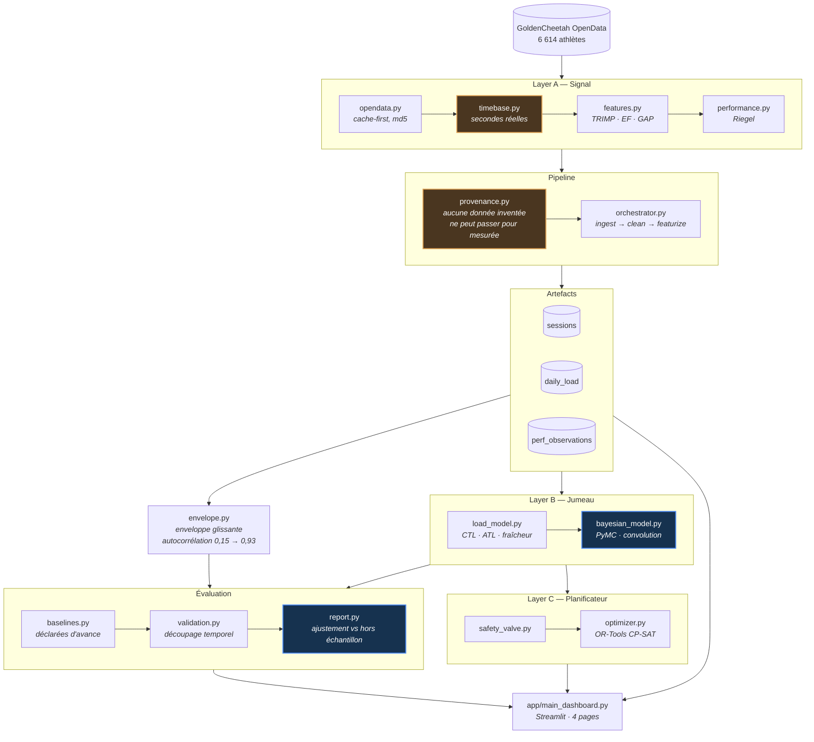

# Digital Twin — Endurance

Un jumeau numérique d'entraînement d'endurance, construit sur des données
publiques : il ingère des séances, en dérive une charge et une mesure de
performance, ajuste un modèle fitness-fatigue bayésien — puis **vérifie
honnêtement si ce modèle prédit quoi que ce soit**.

La réponse mesurée est **non**, et c'est le résultat principal du projet.

---

## Le résultat

Sur 917 séances réelles, en validation croisée temporelle :

| variante | R² ajustement | R² hors échantillon |
|---|---:|---:|
| **persistance** (répéter la dernière valeur) | −0,023 | **+0,318** |
| moyenne mobile exponentielle | −0,215 | +0,081 |
| tendance temporelle | +0,271 | +0,042 |
| prédire la moyenne | 0,000 | −0,014 |
| fitness seul | +0,066 | −0,060 |
| **Banister (fitness + fatigue)** | **+0,107** | **−0,090** |

Trois choses s'y lisent.

**Banister a le meilleur ajustement et le pire score hors échantillon.** Il
mémorise, il n'apprend pas. C'est la signature même du surapprentissage,
et elle réplique la critique publiée dans [*Scientific Reports* (2025)](https://www.nature.com/articles/s41598-025-88153-7)
sur le mauvais conditionnement du modèle fitness-fatigue.

**La tendance passe de +0,271 à +0,042.** Un bon ajustement ne vaut rien en
soi — c'est pour cela que ce dépôt ne publie jamais un R² d'ajustement seul.

**Ce qui prédit, c'est l'inertie.** La persistance obtient +0,318, et aucun
modèle de charge ne la bat.

---

## Ce qui rend ce résultat possible

Le projet mesurait initialement la performance par le **meilleur effort de
chaque séance**. C'est un mauvais estimande : il décrit ce qu'*était* la
séance — fractionné ou récupération — pas la capacité de l'athlète.

| observable | autocorrélation (retard 1) |
|---|---:|
| meilleur effort de séance, course | −0,12 |
| meilleur effort de séance, puissance 20 min | −0,00 |
| **enveloppe glissante 42 j, course** | **+0,79** |
| **enveloppe glissante 42 j, vélo** | **+0,93** |

Du bruit autour d'un niveau : aucun modèle ne pouvait en tirer quoi que ce
soit. L'enveloppe répond à une autre question — « quel est le meilleur dont
cet athlète ait été capable récemment ? » — et devient prédictible.

Contrepartie assumée : une enveloppe est autocorrélée **par construction**,
donc facile à prédire par simple inertie. C'est exactement pourquoi la
persistance figure parmi les références obligatoires ; sans elle, le +0,318
se raconterait comme un succès du modèle.

---

## Architecture



---

## Démarrage

```bash
pip install -e ".[dev]"

python -m src.cli screen-athletes --n 200   # trouver un athlète exploitable
python -m src.cli ingest                    # construire les trois artefacts
python -m src.cli calibrate                 # reporter les estimations
python -m src.cli state                     # résumer ce qui existe

streamlit run app/main_dashboard.py
pytest                                      # hors ligne par défaut
```

Ces commandes reproduisent **chaque chiffre de ce README** à partir d'un jeu
de données public. C'est ce qui les rend vérifiables plutôt que déclaratives.

---

## Ce qui est réel, et ce qui ne l'est pas

**Réel.** 917 séances d'un athlète de GoldenCheetah OpenData, d'août 2014 à
janvier 2020 : 648 vélo, 172 course, 49 sans discipline, 23 home-trainer,
21 natation. Aucune donnée personnelle, aucune coordonnée GPS.

**Validé contre une implémentation externe.** GoldenCheetah publie son propre
TRIMP. Régression du nôtre contre le sien sur 863 séances : **pente 0,934,
ordonnée +1,05, r = 0,982, écart-type résiduel 15,6**. La pente compte
davantage que la corrélation — elle dit que notre échelle est 7 % plus basse.
Un coefficient de rang aurait donné 0,97 en masquant complètement cet écart,
alors que le TRIMP est précisément une grandeur d'échelle qui alimente une
convolution linéaire.

**Estimé, pas supposé.** FC max 194 bpm et FC repos 62 bpm, dérivées de
l'historique. La version précédente supposait 205 et 65, annotées « à
calibrer », alors que tout le TRIMP en dépend.

**Absent, et non simulé.** Ni ce jeu de données ni les fichiers `.fit` d'une
montre Coros ne contiennent d'intervalles RR. Le DFA α₁ renvoie donc `NaN`,
et deux des règles de sécurité n'ont aucune source. Une version antérieure
fabriquait ces intervalles par un processus AR(1) à graine fixe et s'en
servait pour bloquer des séances à haute intensité ; le générateur vit
désormais dans `tests/fixtures/`, sous un nom qui dit ce qu'il produit.

**Extrapolé, et signalé comme tel.** Les prédictions de chrono au-delà de
45 minutes extrapolent une loi de Riegel ajustée sur des efforts de 5 à
45 minutes (exposant 0,0771, R² 0,987). Aucun semi-marathon ne figure dans
les données de cet athlète.

---

## Limites connues

**Le vélo pèse 80 % de la charge, la course seulement 13 %.** Pourtant la
course est longtemps restée la seule discipline où la performance était
mesurée : le modèle devait deviner une capacité de course à partir d'une
charge très majoritairement cycliste. La puissance critique du vélo est
désormais mesurée aussi, ce qui atténue le déséquilibre sans l'effacer.

**k₂ ressort négatif** — une fatigue élevée améliorerait la performance. Le
conditionnement de la matrice vaut 5, ce qui disculpe la colinéarité : il
s'agit d'endogénéité du moment de mesure, les séances rapides tombant pendant
les blocs de charge. Le signe n'est pas contraint dans le modèle, parce que
le forcer masquerait le résultat.

**Un seul athlète.** Deux autres sont retenus dans
`config/opendata_manifest.json` mais ne servent pas encore de contrôle.

**L'enveloppe est autocorrélée par construction**, donc facile à prédire. Le
+0,318 de la persistance mesure l'inertie, pas une compréhension de la
physiologie.

---

## Garde-fous du dépôt

Ces règles sont appliquées par le code et par les tests, pas seulement
documentées. Le détail est dans [`AGENTS.md`](AGENTS.md).

- **Provenance obligatoire.** `DataSource` n'a pas de valeur par défaut ;
  écrire du synthétique exige `allow_synthetic=True`. Le tableau de bord a
  autrefois affiché 84 séances générées sous l'étiquette `fit_file`.
- **Aucune métrique ne compte des lignes.** Tout passe par `timebase.py` et
  s'exprime en secondes réelles ; les séries ne sont pas garanties à 1 Hz.
- **Aucune constante physiologique dans le code.** Elles vivent dans
  `config/params.yaml`, et valent `null` tant que la calibration n'a pas
  tourné — une erreur explicite plutôt qu'un nombre inventé.
- **Aucune amélioration affirmée sans validation hors échantillon.**
- **Les tests n'écrivent jamais dans `data/`** ; une fixture le vérifie après
  chaque test.

Le noyau de convolution du modèle bayésien est testé contre le filtre
récursif de `load_model.py` à 1e-10 près : une seule source de vérité pour la
dynamique de charge. Et un test de **récupération de paramètres** simule
depuis des valeurs connues puis vérifie que le postérieur les retrouve — les
cinq tombent dans leur intervalle de crédibilité à 94 %.

---

## Stack

`pandas` · `numpy` · `scipy` · `pyarrow` · `PyMC` / `ArviZ` · `OR-Tools`
CP-SAT · `Streamlit` · `Plotly` · `pytest` · `ruff`

Données : [GoldenCheetah OpenData](https://osf.io/6hfpz/), DOI
[10.17605/OSF.IO/6HFPZ](https://doi.org/10.17605/OSF.IO/6HFPZ).

---

*Projet personnel — Louis Rodembourg*
