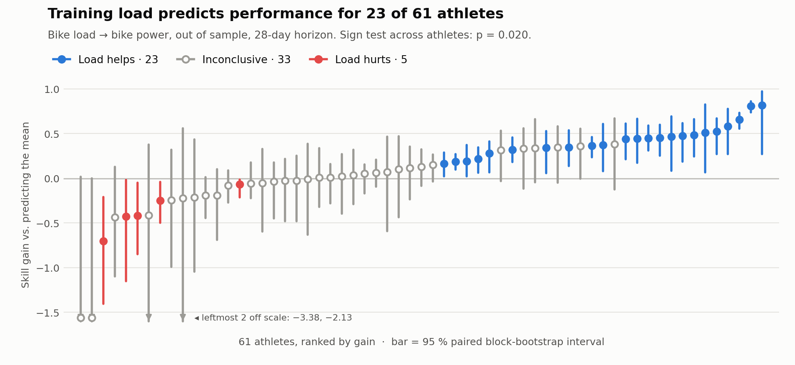

# Adaptive Digital Twin — Endurance

[](https://github.com/louisrodembourg/Adaptive-digital-twin-endurance/actions/workflows/ci.yml)


**A digital twin for endurance training that learns how each athlete responds
to training load — and says when it can't tell.**

It ingests real sessions from a public dataset, turns them into a training
load and a performance measure, fits physiological models, validates them out
of sample on 61 athletes, and plans the next week accordingly.

<picture>
  <source media="(prefers-color-scheme: dark)" srcset="docs/figures/cohort_skill_dark.png">
  
</picture>

<sub>Reproduce with `python -m src.cli cohort` then `python docs/figures/make_figures.py`.</sub>

---

## Key results

| | result | evidence |
|---|---|---|
| **Load predicts performance** when matched to its discipline | bike load beats "predict the mean" by **+0.339** | 95 % CI [+0.055 · +0.524], 38 time-ordered folds |
| **It replicates** across athletes | **23 / 61** athletes with an interval excluding zero | sign test **p = 0.020** |
| **Matching the discipline is what matters** | bike load beats running load on bike power by **+0.481** (median) | 14 / 35 in favour, **0 against**, p = 0.0001 |
| **The response is individual** | between-athlete dispersion **0.205** | 94 % HDI [+0.131 · +0.278], hierarchical model, 62 athletes |
| **A safety rule is validated on real data** | keeping ACWR ≥ 0.8 is followed by better efforts | 6,768 weeks, 66 athletes, p = 0.0145 |

Every number above is reproduced by a command on public data — see
[Quick start](#quick-start).

---

## The approach

The project started from a simple question and followed the evidence.

**1. Question.** The Banister fitness-fatigue model (1975) sits behind most
training platforms. Does it actually *predict* performance, out of sample?

**2. Build the measuring instrument first.** Before any model: time-ordered
cross-validation, baselines declared in advance (including "repeat the last
value"), a paired block bootstrap so every gap comes with an interval, and a
detectability floor so a null result says what effect it *could* have seen.

**3. First answer: no.** On a running target, Banister had the best in-sample
fit and the worst out-of-sample score — it memorised. Persistence won.

| variant | in-sample R² | out-of-sample R² |
|---|---:|---:|
| persistence (repeat the last value) | −0.023 | **+0.318** |
| predict the mean | 0.000 | −0.014 |
| Banister (fitness + fatigue) | **+0.107** | −0.090 |

**4. Diagnose instead of concluding.** Two design errors explained it:
- *the estimand* — the best effort of each session measures what the session
  was (intervals or recovery), not the athlete's capacity (autocorrelation
  −0.12). A 42-day rolling performance envelope fixes it (+0.93 on cycling);
- *the pairing* — 68.5 % of the load was **cycling**, set against a
  **running** speed.

**5. Fix and replicate.** Bike load against bike power: the load model beats
the mean, running load serves as a negative control and fails (as it should),
and the effect replicates on 61 athletes. It is also **heterogeneous**: detected
in 23, inconclusive in 33, harmful in 5 — measured, not assumed.

**6. Turn the result into a product decision.** Because the dose-response is
individual, the planner does not maximise load. It searches for the
**minimum load** that delivers the requested stimulus, under safety bounds, and
reports the verdict measured *for the athlete in front of it*:

```
$ python -m src.cli plan
Ce plan cherche la charge la PLUS FAIBLE qui délivre le stimulus demandé,
sous les contraintes de sécurité.
Dose-reponse detectee chez cet athlete : competence +0.339 contre « moyenne »,
IC 95 % [+0.055 · +0.524], 38 plis.
```

*(The CLI speaks French: "this plan looks for the LOWEST load that delivers the
requested stimulus… dose-response detected for this athlete: skill +0.339 vs.
mean.")* A new athlete gets a **maturity ladder** instead: which capabilities
are available today, how many days the others need, and what the cohort says
in the meantime.

---

## Architecture

```
raw sessions ─▶ Layer A: Signal ─▶ Layer B: Twin ─▶ Layer C: Planner ─▶ weekly plan
                cleaning, TRIMP,    load curves,     dose-response
                performance         Bayesian &       verdict, safety
                envelope            hierarchical     bounds, CP-SAT
                                    models
                         └──────── Evaluation ────────┘
               baselines · time-ordered CV · paired bootstrap ·
               detectability floors · cohort replication
```

Details, modules and data flow: [docs/architecture.md](docs/architecture.md).

---

## Quick start

```bash
pip install -e ".[dev]"

python -m src.cli ingest          # sessions → load, performance, provenance
python -m src.cli calibrate       # max/resting HR estimated, never assumed
python -m src.cli evaluate        # 5 validation protocols + detectability floors
python -m src.cli cohort          # replication on 61 athletes
python -m src.cli plan            # next week, and what it does not promise
python -m src.cli validate-plan   # the planner's safety bounds against real data
python -m src.cli responders      # who responds, tested out of sample
python -m src.cli pool            # hierarchical Bayesian model (~2 h 30)

streamlit run app/main_dashboard.py
pytest                            # 400+ tests, offline by default
```

Optional foundation models (Chronos-2, TTM):
`pip install -e ".[tsfm]"` then `python -m src.cli evaluate --models chronos2,ttm`.

---

## Engineering highlights

- **Bayesian modelling with PyMC.** The posterior revealed what a point fit
  would have hidden: fitness and fatigue gains correlated at 0.986, the
  single-athlete model is not identified. Reparametrising on the net effect cut
  sampling from **22 hours to 26 minutes**.
- **Hierarchical pooling across 62 athletes** to identify the time constants
  and the between-athlete dispersion — then a control experiment showing about
  a quarter of those constants is an artefact of the smoothing window.
- **Constraint optimisation with OR-Tools CP-SAT.** Training rules are
  combinatorial (hard/easy spacing, repetition bounds, load ramps), not
  continuous.
- **Foundation models as a non-parametric referee.** Chronos-2 (120 M
  parameters) given past and future load tests whether load carries
  information without assuming a functional form. A test also showed that
  TTM's advertised covariate support is inert in zero-shot — bit-for-bit.
- **Provenance enforced in code.** Every session carries an explicit data
  source; synthetic data requires an explicit flag; a fixture checks that no
  test writes to `data/`. No physiological constant is hard-coded.
- **Validated against an external implementation.** Our TRIMP against
  GoldenCheetah's on 863 sessions: r = 0.982, slope 0.934.

Stack: `pandas` · `numpy` · `scipy` · `PyMC` / `ArviZ` · `OR-Tools` ·
`Streamlit` · `Plotly` · `pytest` · `ruff` — optional `torch` ·
`chronos-forecasting` · `granite-tsfm`.

---

## What's missing to go further

The method is in place and has produced a replicated result. What limits the
next step is data, and each gap is known and quantified:

| missing | what it would unlock |
|---|---|
| **Session types** (intervals, tempo, endurance) — absent from public summaries | validating the planner's per-type ceilings, the half of it not yet measured |
| **More athletes** (beyond 61) | predicting *who* responds from training history — the current test misses its detectability floor at 0.40 σ |
| **Declared maximal efforts** (tests, races) | a performance target that measures capacity, not the ride |
| **HRV, sleep, perceived exertion** | a measured fatigue state; the HRV safety rule is wired but has no input |
| **Running data across several athletes** | a cohort result for the second discipline, today based on one athlete |
| **Planned (not realised) future load** | an honest score for the planner in real use |

What is already settled: nothing known about an athlete **on day one** predicts
whether they will respond (well-powered null, floor 0.05 σ) — which is why the
system measures the response per athlete rather than guessing it.

---

## Lessons learned

- **The estimand matters more than the model.** Changing the question asked of
  the data did more than any change of algorithm.
- **Fitting is not predicting.** The hierarchical model finds a load effect in
  61 of 62 athletes in sample; out of sample, 23 of 61. Every fit here is
  published with its out-of-sample counterpart.
- **A gap without an interval is worth nothing.** Chronos-2 ranks first by
  0.003 R²; the paired bootstrap says [−0.172 · +0.255].
- **"Found nothing" is not "nothing there".** Two conclusions flipped as the
  cohort grew from 13 to 61 athletes; a detectability floor says in advance
  how many subjects a question needs.
- **A clean p-value can be an artefact.** A naive protocol said a safety rule
  cost 0.333 σ at p < 0.0001. Three confounders later, the effect was −0.042,
  p = 0.18.

---

## Documentation

| | |
|---|---|
| [**Results**](docs/results.md) | full log of measurements, every table |
| [**Method**](docs/method.md) | protocols, what is real, what is missing, safeguards |
| [**Architecture**](docs/architecture.md) | modules, data flow, getting started |
| [**AGENTS.md**](AGENTS.md) | the repository's non-negotiable rules |

Data: [GoldenCheetah OpenData](https://osf.io/6hfpz/) — public, anonymised, no
GPS coordinates. License: [MIT](LICENSE).
