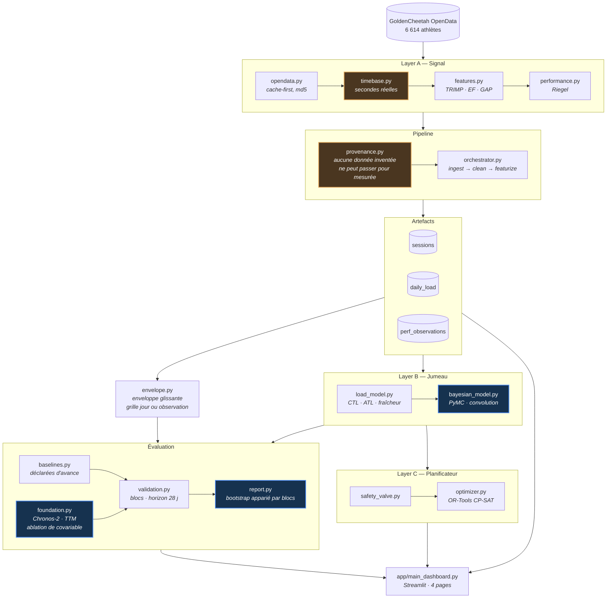

# Digital Twin — Endurance

Un jumeau numérique d'entraînement d'endurance, construit sur des données
publiques : il ingère des séances, en dérive une charge et une mesure de
performance, ajuste un modèle fitness-fatigue bayésien — puis **vérifie
honnêtement si ce modèle prédit quoi que ce soit**.

La réponse mesurée est **non**, et c'est le résultat principal du projet.

---

## Le résultat

Sur 917 séances réelles, en validation croisée temporelle :

| variante | R² ajustement | R² hors échantillon |
|---|---:|---:|
| **persistance** (répéter la dernière valeur) | −0,023 | **+0,318** |
| moyenne mobile exponentielle | −0,215 | +0,081 |
| tendance temporelle | +0,271 | +0,042 |
| prédire la moyenne | 0,000 | −0,014 |
| fitness seul | +0,066 | −0,060 |
| **Banister (fitness + fatigue)** | **+0,107** | **−0,090** |

Trois choses s'y lisent.

**Banister a le meilleur ajustement et le pire score hors échantillon.** Il
mémorise, il n'apprend pas. C'est la signature même du surapprentissage,
et elle réplique la critique publiée dans [*Scientific Reports* (2025)](https://www.nature.com/articles/s41598-025-88153-7)
sur le mauvais conditionnement du modèle fitness-fatigue.

**La tendance passe de +0,271 à +0,042.** Un bon ajustement ne vaut rien en
soi — c'est pour cela que ce dépôt ne publie jamais un R² d'ajustement seul.

**Ce qui prédit, c'est l'inertie.** La persistance obtient +0,318, et aucun
modèle de charge ne la bat.

---

## Ce qui rend ce résultat possible

Le projet mesurait initialement la performance par le **meilleur effort de
chaque séance**. C'est un mauvais estimande : il décrit ce qu'*était* la
séance — fractionné ou récupération — pas la capacité de l'athlète.

| observable | autocorrélation (retard 1) |
|---|---:|
| meilleur effort de séance, course | −0,12 |
| meilleur effort de séance, puissance 20 min | −0,00 |
| **enveloppe glissante 42 j, course** | **+0,79** |
| **enveloppe glissante 42 j, vélo** | **+0,93** |

Du bruit autour d'un niveau : aucun modèle ne pouvait en tirer quoi que ce
soit. L'enveloppe répond à une autre question — « quel est le meilleur dont
cet athlète ait été capable récemment ? » — et devient prédictible.

Contrepartie assumée : une enveloppe est autocorrélée **par construction**,
donc facile à prédire par simple inertie. C'est exactement pourquoi la
persistance figure parmi les références obligatoires ; sans elle, le +0,318
se raconterait comme un succès du modèle.

---

## Ce que dit le postérieur

Le modèle bayésien est ajusté par MCMC sur les 1 987 jours de charge et les
85 points d'enveloppe. L'échantillonnage converge proprement — `r_hat` à
1,0000 sur tous les paramètres, aucune divergence, ESS minimal de 746 — ce
qui rend ses diagnostics interprétables.

| paramètre | moyenne | écart-type | intervalle 94 % |
|---|---:|---:|---|
| τ₁ (fitness, jours) | 29,3 | 11,7 | [9,1 · 51,1] |
| τ₂ (fatigue, jours) | 13,6 | 4,8 | [4,5 · 22,1] |
| k₁ (gain fitness) | 0,050 | 0,032 | [0,007 · 0,112] |
| k₂ (gain fatigue) | 0,050 | 0,040 | [−0,004 · 0,127] |
| **k₁ − k₂ (effet net)** | **−0,000** | **0,010** | **[−0,020 · 0,017]** |

**L'effet net de la charge d'entraînement sur la performance est
indiscernable de zéro.** Ce n'est pas une estimation imprécise faute de
données : l'intervalle est étroit, centré sur zéro, et issu d'un
échantillonnage convergé.

**k₁ et k₂ sont corrélés à 0,986.** Les données ne distinguent pas un gain de
fitness élevé compensé par une pénalité de fatigue élevée d'une paire de
gains modestes — seule leur différence est contrainte. Le postérieur de τ₁ ne
se resserre que de 41 % par rapport à son prior : les constantes de temps ne
sont pas identifiées non plus.

**L'intervalle de prédiction à 95 % ne couvre que 34 % des observations.** Le
modèle est massivement surconfiant.

Un postérieur plat est un résultat, pas un échec. C'est le seul usage honnête
de l'inférence bayésienne ici : montrer ce que les données contraignent
réellement, là où un ajustement ponctuel aurait présenté k₁ = 0,050 comme une
valeur estimée.

> **Note d'ingénierie.** Cette géométrie coûte cher : avec des paramètres
> corrélés à 0,99, NUTS ne parcourt la crête qu'à tout petits pas, et le
> premier ajustement a demandé **22 heures**. Échantillonner l'effet net
> plutôt que chaque gain — même modèle, autre paramétrisation — le ramène à
> **26 minutes**, soit un facteur 51.

---

## Ce que disent les modèles de fondation

Le résultat ci-dessus repose sur **un seul modèle paramétrique**. Une
objection reste donc ouverte : peut-être que la charge prédit la performance,
mais pas sous la forme d'une convolution exponentielle à deux constantes de
temps.

Les modèles de fondation de séries temporelles permettent de la tester sans
supposer de forme fonctionnelle. [Chronos-2](https://huggingface.co/amazon/chronos-2)
accepte des covariables passées et futures connues : on lui donne l'enveloppe
comme cible et la charge comme covariable, puis on le compare **au même
modèle privé de la covariable**. L'écart entre les deux lignes est une mesure
non paramétrique de l'information que la charge porte sur la performance.

Les covariables fournies ne sont pas le seul TRIMP brut : elles incluent
`fitness` et `fatigue`, calculés par la même fonction que celle qui alimente
le modèle bayésien. Le modèle reçoit donc **exactement les régresseurs de
Banister**, libre de les combiner autrement. Un résultat nul ne pourra pas
s'expliquer par une mise en forme insuffisante.

### Le résultat

Protocole à horizon calendaire de 28 jours, 18 plis à origine glissante,
545 jours d'enveloppe définie :

| variante | R² ajustement | R² hors échantillon | plis |
|---|---:|---:|---:|
| **Chronos-2 + charge** | — | **+0,657** | 18 |
| **persistance** | −0,008 | **+0,654** | 18 |
| Chronos-2 sans charge | — | +0,621 | 18 |
| TTM sans charge | — | +0,514 | 17 |
| moyenne mobile exponentielle | −0,001 | +0,503 | 18 |
| tendance temporelle | +0,281 | +0,122 | 18 |
| prédire la moyenne | +0,000 | +0,090 | 18 |
| fitness seul (τ 60) | +0,099 | +0,050 | 18 |
| Banister (τ 42/12) | +0,100 | −0,017 | 18 |

Chronos-2 nourri de la charge arrive premier. **De +0,003.** Un classement
n'est pas une mesure, et un écart de cette taille ne veut rien dire tant
qu'on ne l'a pas borné. Les deux variantes prédisent exactement les mêmes
points sous le même découpage, ce qui autorise un bootstrap apparié — par
**blocs**, puisque les erreurs d'un même pli sont fortement autocorrélées et
que tirer des jours indépendamment supposerait 545 observations
indépendantes là où il y en a 18 :

| comparaison | gain | intervalle 95 % | P(gain) |
|---|---:|---|---:|
| Chronos-2 + charge **contre** Chronos-2 sans charge | +0,096 | [−0,121 · +0,430] | 0,70 |
| Chronos-2 + charge **contre** persistance | +0,008 | [−0,172 · +0,255] | 0,55 |

**Aucun des deux écarts ne survit.** Le gain apporté par la charge est
compatible avec zéro, et le premier rang de Chronos-2 face à la persistance
est un tirage à pile ou face. Un modèle de 120 millions de paramètres,
entraîné sur des corpus de séries que ce projet n'a pas, à qui l'on donne la
charge passée *et future* — donc plus d'information qu'aucun planificateur
n'en aurait — n'extrait rien de plus que « répéter la dernière valeur ».

C'est le même constat que celui du postérieur bayésien, obtenu par une voie
qui ne partage avec lui ni hypothèse de forme, ni méthode d'inférence, ni
code. C'est ce qui le rend intéressant.

### Trois choses que la mesure a appris en chemin

**Un modèle zero-shot n'a pas de R² d'ajustement.** La colonne est vide pour
les trois lignes de fondation, et c'est un résultat : ces modèles n'ajustent
rien, leurs poids sont figés. L'écart ajustement / hors échantillon n'existe
pas, donc il n'y a **aucun surapprentissage à mesurer** — exactement
l'inverse de Banister, dont le meilleur ajustement accompagnait le pire score
hors échantillon.

**L'exogène annoncé par TTM est inerte en zero-shot.** La fiche de
[granite-timeseries-ttm](https://huggingface.co/ibm-granite/granite-timeseries-ttm-r3)
annonce l'« intégration de variables exogènes ». Mesure faite : en remplaçant
entièrement les canaux de covariables, la prévision du canal cible est
identique **au bit près** — le dorsal est indépendant par canal et
`enable_forecast_channel_mixing` vaut `False`. Son exogène demande un
fine-tuning. TTM n'est donc enregistré qu'en univarié, et `foundation.py`
refuse `with_covariates=True` pour lui plutôt que de publier deux lignes
qu'on sait égales. Un test le vérifie.

**TTM n'a couvert que 17 plis sur 18.** Sa tête est entraînée pour un horizon
de 96 pas ; le premier pli en demande 152, à cause d'une interruption de
mesure de 135 jours chez cet athlète. Sa ligne ne porte donc pas sur les
mêmes points que les autres. C'est pour cela que la colonne `plis` existe :
sans elle la comparaison paraîtrait à armes égales, et `cli evaluate`
avertit sur la sortie d'erreur quand les plis diffèrent.

### Les deux protocoles ne se comparent pas entre eux

La persistance passe de **+0,318** (protocole en blocs, plus haut) à
**+0,654** ici. Rien ne s'est amélioré : la cible a changé de grille.

L'enveloppe telle que le dépôt la rapportait n'existe qu'aux jours où une
mesure existe — 85 points espacés de 1 à 140 jours. Un bloc de test couvre
alors une durée très variable, et le score agrégé mélange des prévisions à
une semaine et à cinq mois ; comme mesure d'un horizon de prévision, cela ne
veut rien dire. Les modèles de fondation, eux, supposent presque tous un pas
d'échantillonnage constant.

D'où la grille journalière. Ce n'est **pas** une interpolation : un maximum
glissant sur 42 jours est défini pour chaque jour du calendrier à partir des
seules mesures réelles de sa fenêtre, et le code ne le demandait simplement
jamais. Un test l'impose — la sortie journalière, restreinte aux dates
d'observation, est identique à l'ancienne. Les jours où l'enveloppe n'est pas
définie portent `NaN`, jamais la dernière valeur connue : reporter aurait
fabriqué de la donnée et, pire, rendu la cible artificiellement facile à
prédire par persistance.

Cette grille est plus dense et plus autocorrélée (0,974 au retard 1, contre
0,79 pour les 85 points), donc tous les scores montent. Le classement
relatif, lui, est inchangé : aucun modèle de charge ne bat l'inertie.

### Les modèles retenus, et ceux qui ne l'ont pas été

| modèle | taille | licence des poids | covariables zero-shot | exécuté |
|---|---:|---|---|---|
| [Chronos-2](https://huggingface.co/amazon/chronos-2) | 120 M | Apache-2.0 | passées **et futures connues** | **oui** |
| [TTM](https://huggingface.co/ibm-granite/granite-timeseries-ttm-r3) (IBM granite) | 855 k | Apache-2.0 | aucune — mesuré | **oui, univarié** |
| [TabPFN-TS](https://github.com/PriorLabs/tabpfn-time-series) | 11 M | Apache-2.0, **poids sous compte** | oui | non |
| [TimesFM 2.5](https://huggingface.co/google/timesfm-2.5-200m-pytorch) | 200 M | Apache-2.0 | aucune | non |
| TimesFM 3.0 | 330 M | **non commerciale** | oui | non |
| [Moirai-2](https://huggingface.co/Salesforce/moirai-2.0-R-small) | 11 M | **CC BY-NC 4.0** | — | non |

Quatre exclusions, quatre raisons distinctes, aucune liée à la performance.

**Moirai-2 et TimesFM 3.0 interdisent l'usage commercial de leurs poids.** Ce
sont deux des modèles que les comparatifs placent en tête. Ce dépôt est sous
MIT ; les citer sans les exécuter est le choix cohérent.

**Les poids de TabPFN ne se téléchargent pas sans compte.** Le code est sous
Apache-2.0, mais `tabpfn` 9.x exige une acceptation de licence interactive et
une clé `TABPFN_TOKEN` obtenue chez Prior Labs. L'adaptateur est écrit et
fonctionnel ; aucun chiffre n'est publié tant qu'il n'a pas tourné.

**TimesFM 2.5 n'accepte aucune covariable**, ce qui le rend inutile pour la
seule question posée ici.

Un détail de version qui compte : le point de contrôle réellement chargé pour
TTM est **R2, pas R3**. `granite-tsfm` 0.3.10, dernière version publiée sur
PyPI, ne sait pas lire les points de contrôle R3 — la moitié des poids, dont
la tête multi-quantile, est réinitialisée au hasard et la sortie n'est pas
finie. La clé de la variante s'appelle `ttm` et non `ttm-r3` pour cette
raison, et un test l'affirme.

### Sur cette machine

Latences mesurées sur un MacBook Pro M3 Pro, 18 Go, **CPU uniquement**,
chargement des poids exclu du chronomètre :

| modèle | par prévision | poids |
|---|---:|---:|
| Chronos-2, avec covariables | 138 ms | 120 M |
| Chronos-2, univarié | 155 ms | 120 M |
| TTM | **3 ms** | 855 k |

Les 3 ms de TTM reproduisent exactement le chiffre publié par IBM. Aucun GPU
n'est nécessaire : le premier chargement de Chronos-2 prend une centaine de
secondes, puis le pipeline est mis en cache et les 18 plis passent en
quelques secondes.

```bash
pip install -e ".[tsfm]"          # torch, chronos-forecasting, granite-tsfm
python -m src.cli evaluate --models chronos2,ttm
```

La commande écrit `data/processed/evaluation_results.parquet` et un JSON de
provenance qui porte les versions de paquets, les révisions de poids, les
paramètres de protocole et les latences. Elle rend les **deux** protocoles :
les six lignes du tableau en tête de ce README, qu'il fallait auparavant
recopier depuis le tableau de bord, en sortent désormais au chiffre près.
C'est aussi ce qui les protège — toute dérive sur ces six lignes signale une
régression de la cible ou du découpage, pas un résultat.

---

## Architecture



---

## Démarrage

```bash
pip install -e ".[dev]"

python -m src.cli screen-athletes --n 200   # trouver un athlète exploitable
python -m src.cli ingest                    # construire les trois artefacts
python -m src.cli calibrate                 # reporter les estimations
python -m src.cli state                     # résumer ce qui existe
python -m src.cli evaluate                  # confronter chaque variante

streamlit run app/main_dashboard.py
pytest                                      # hors ligne par défaut
```

Les modèles de fondation sont en option, parce que `torch` pèse environ 2 Go
et qu'aucun chiffre ci-dessus n'en a besoin pour être reproduit :

```bash
pip install -e ".[tsfm]"
python -m src.cli evaluate --models chronos2,ttm
```

Ces commandes reproduisent **chaque chiffre de ce README** à partir d'un jeu
de données public. C'est ce qui les rend vérifiables plutôt que déclaratives.

---

## Ce qui est réel, et ce qui ne l'est pas

**Réel.** 917 séances d'un athlète de GoldenCheetah OpenData, d'août 2014 à
janvier 2020 : 648 vélo, 172 course, 49 sans discipline, 23 home-trainer,
21 natation. Aucune donnée personnelle, aucune coordonnée GPS.

**Validé contre une implémentation externe.** GoldenCheetah publie son propre
TRIMP. Régression du nôtre contre le sien sur 863 séances : **pente 0,934,
ordonnée +1,05, r = 0,982, écart-type résiduel 15,6**. La pente compte
davantage que la corrélation — elle dit que notre échelle est 7 % plus basse.
Un coefficient de rang aurait donné 0,97 en masquant complètement cet écart,
alors que le TRIMP est précisément une grandeur d'échelle qui alimente une
convolution linéaire.

**Estimé, pas supposé.** FC max 194 bpm et FC repos 62 bpm, dérivées de
l'historique. La version précédente supposait 205 et 65, annotées « à
calibrer », alors que tout le TRIMP en dépend.

**Absent, et non simulé.** Ni ce jeu de données ni les fichiers `.fit` d'une
montre Coros ne contiennent d'intervalles RR. Le DFA α₁ renvoie donc `NaN`,
et deux des règles de sécurité n'ont aucune source. Une version antérieure
fabriquait ces intervalles par un processus AR(1) à graine fixe et s'en
servait pour bloquer des séances à haute intensité ; le générateur vit
désormais dans `tests/fixtures/`, sous un nom qui dit ce qu'il produit.

**Extrapolé, et signalé comme tel.** Les prédictions de chrono au-delà de
45 minutes extrapolent une loi de Riegel ajustée sur des efforts de 5 à
45 minutes (exposant 0,0771, R² 0,987). Aucun semi-marathon ne figure dans
les données de cet athlète.

---

## Limites connues

**Le vélo pèse 80 % de la charge, la course seulement 13 %.** Pourtant la
course est longtemps restée la seule discipline où la performance était
mesurée : le modèle devait deviner une capacité de course à partir d'une
charge très majoritairement cycliste. La puissance critique du vélo est
désormais mesurée aussi, ce qui atténue le déséquilibre sans l'effacer.

**Le modèle n'est pas identifié.** k₁ et k₂ sont corrélés à 0,986 dans le
postérieur, et les constantes de temps ne se resserrent que de 41 % par
rapport à leur prior. À constantes de temps *fixées*, la colinéarité paraît
modérée — le conditionnement de la matrice des moindres carrés vaut 5 — mais
dès que τ est échantillonné, τ et k se compensent et la dégénérescence
apparaît. Seul le postérieur la révèle. Le signe de k₂ n'est pas contraint
dans le modèle : le forcer masquerait précisément ce résultat.

**Un seul athlète.** Deux autres sont retenus dans
`config/opendata_manifest.json` mais ne servent pas encore de contrôle.

**L'enveloppe est autocorrélée par construction**, donc facile à prédire. Le
+0,318 de la persistance mesure l'inertie, pas une compréhension de la
physiologie.

**Les modèles de fondation reçoivent la charge future.** C'est délibéré — la
question posée est « la charge porte-t-elle de l'information sur la
performance ? », et la lui refuser rendrait un résultat nul inexploitable.
Mais cela veut dire que le +0,657 de Chronos-2 n'est pas un chiffre de
planificateur : en usage réel, la charge à venir n'est pas connue. Le score
honnête d'un planificateur serait plus bas, et il reste à mesurer.

**Un résultat nul ne vaut que sur ces données.** Dix-huit plis, un athlète,
une discipline majoritaire. L'intervalle apparié de [−0,121 · +0,430] dit que
ce protocole ne peut pas exclure un gain réel de covariable allant jusqu'à
+0,43 — il dit seulement qu'il n'en détecte pas. Les deux lectures comptent.

---

## Garde-fous du dépôt

Ces règles sont appliquées par le code et par les tests, pas seulement
documentées. Le détail est dans [`AGENTS.md`](AGENTS.md).

- **Provenance obligatoire.** `DataSource` n'a pas de valeur par défaut ;
  écrire du synthétique exige `allow_synthetic=True`. Le tableau de bord a
  autrefois affiché 84 séances générées sous l'étiquette `fit_file`.
- **Aucune métrique ne compte des lignes.** Tout passe par `timebase.py` et
  s'exprime en secondes réelles ; les séries ne sont pas garanties à 1 Hz.
- **Aucune constante physiologique dans le code.** Elles vivent dans
  `config/params.yaml`, et valent `null` tant que la calibration n'a pas
  tourné — une erreur explicite plutôt qu'un nombre inventé.
- **Aucune amélioration affirmée sans validation hors échantillon**, ni sans
  intervalle quand deux variantes se tiennent à quelques millièmes de R². Un
  classement n'est pas une mesure : `report.paired_table` compare les
  variantes point à point, par bootstrap apparié sur les plis.
- **Un modèle qui n'a rien exécuté ne publie rien.** `cross_validate` avale
  les exceptions d'un prédicteur ; une variante cassée ressortirait en
  `folds = 0` avec des NaN, ce qui ressemble à un résultat mesuré.
  `cli evaluate` sort en erreur dans ce cas, et avertit quand deux variantes
  n'ont pas couvert le même nombre de plis.
- **Aucune capacité annoncée n'est crue sur parole.** L'« intégration de
  variables exogènes » de TTM est inerte en zero-shot ; un test le mesure en
  remplaçant les covariables et en vérifiant que la sortie ne bouge pas.
- **Les tests n'écrivent jamais dans `data/`** ; une fixture le vérifie après
  chaque test.

Le noyau de convolution du modèle bayésien est testé contre le filtre
récursif de `load_model.py` à 1e-10 près : une seule source de vérité pour la
dynamique de charge. Et un test de **récupération de paramètres** simule
depuis des valeurs connues puis vérifie que le postérieur les retrouve — les
cinq tombent dans leur intervalle de crédibilité à 94 %.

---

## Stack

`pandas` · `numpy` · `scipy` · `pyarrow` · `PyMC` / `ArviZ` · `OR-Tools`
CP-SAT · `Streamlit` · `Plotly` · `pytest` · `ruff`

En option, pour les références à modèle de fondation : `torch` ·
`chronos-forecasting` · `granite-tsfm`.

Données : [GoldenCheetah OpenData](https://osf.io/6hfpz/), DOI
[10.17605/OSF.IO/6HFPZ](https://doi.org/10.17605/OSF.IO/6HFPZ).

---

*Projet personnel — Louis Rodembourg*
