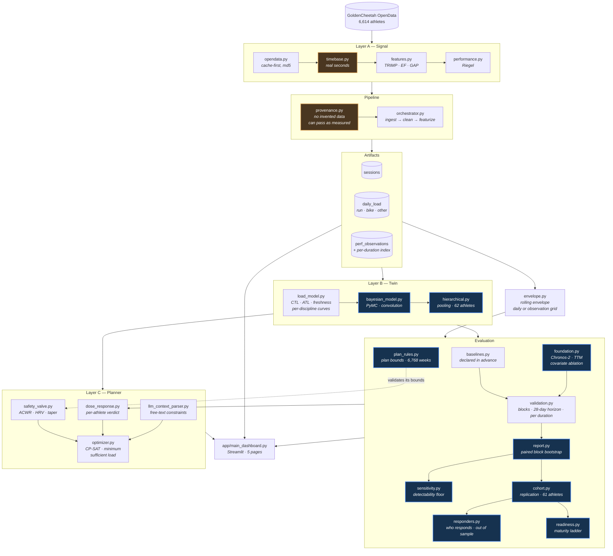

# Architecture and getting started

The modules, the data flow, and the commands.

Short presentation: [README](../README.md).

---

## Architecture



| layer | role |
|---|---|
| **A — Signal** | raw sessions → cleaned series on a real-seconds timebase → TRIMP, efficiency, grade-adjusted pace, performance observations |
| **Pipeline** | orchestration and provenance: every session carries an explicit `DataSource` |
| **B — Twin** | fitness-fatigue load curves per discipline, single-athlete Bayesian model, hierarchical pooling across athletes |
| **Evaluation** | declared baselines, time-ordered validation, paired block bootstrap, detectability floors, cohort replication, safety-rule validation, responder prediction, maturity ladder |
| **C — Planner** | per-athlete dose-response verdict, safety bounds, constraints parsed from free text, CP-SAT optimiser looking for the minimum sufficient load |

---

## Getting started

```bash
pip install -e ".[dev]"

python -m src.cli fetch-athletes --critere course --keep 3   # find a subject
python -m src.cli ingest                    # build the three artifacts
python -m src.cli calibrate                 # write estimates to params.yaml
python -m src.cli state                     # summarise what exists
python -m src.cli evaluate                  # five protocols + floors
python -m src.cli cohort                    # replicate on the athlete cache
python -m src.cli plan                      # propose a week, and what it is worth
python -m src.cli validate-plan             # confront its bounds with data
python -m src.cli responders                # who responds, out of sample
python -m src.cli pool                      # hierarchical pooling (~2 h 30)
python -m src.cli pool --decrire            # the target only, no sampling

streamlit run app/main_dashboard.py
pytest                                      # offline by default
```

Foundation models are optional, because `torch` weighs about 2 GB and no
number in the main results needs it to be reproduced:

```bash
pip install -e ".[tsfm]"
python -m src.cli evaluate --models chronos2,ttm
```

Without `data/processed`, the dashboard reads the frozen snapshot in
[`demo/processed`](../demo/README.md) — real artifacts from the public dataset —
and says so in its sidebar. That is what the online demo serves.

These commands reproduce **every published number** from a public dataset.
That is what makes them verifiable rather than declarative.

The command-line interface and the dashboard speak French; flags such as
`--critere`, `--fenetre`, `--exclure` and `--decrire` are the French words for
criterion, window, exclude and describe.

---

## Stack

`pandas` · `numpy` · `scipy` · `pyarrow` · `PyMC` / `ArviZ` · `OR-Tools`
CP-SAT · `Streamlit` · `Plotly` · `pytest` · `ruff`

Optional, for the foundation-model baselines: `torch` ·
`chronos-forecasting` · `granite-tsfm`.

On the evaluation side, five protocols come out of a single command:
positional blocks, calendar horizon, per-duration envelope, bike target, and
detectability floor.

Data: [GoldenCheetah OpenData](https://osf.io/6hfpz/), DOI
[10.17605/OSF.IO/6HFPZ](https://doi.org/10.17605/OSF.IO/6HFPZ).

---

*Personal project — Louis Rodembourg*
