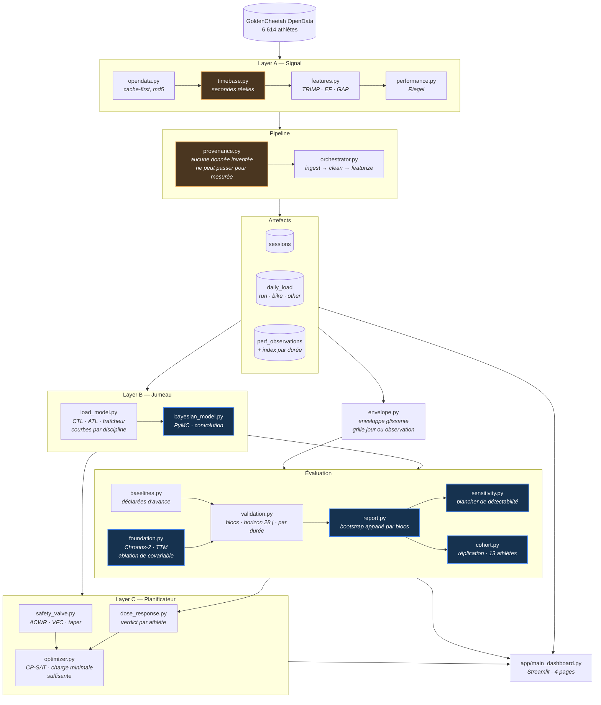

# Architecture et mise en route

Les modules, le flux de données, et les commandes.

Présentation courte : [README](../README.md).

---

## Architecture



---

## Démarrage

```bash
pip install -e ".[dev]"

python -m src.cli screen-athletes --n 200   # trouver un athlète exploitable
python -m src.cli ingest                    # construire les trois artefacts
python -m src.cli calibrate                 # reporter les estimations
python -m src.cli state                     # résumer ce qui existe
python -m src.cli evaluate                  # cinq protocoles + planchers
python -m src.cli cohort                    # répliquer sur le cache d'athlètes
python -m src.cli plan                      # proposer une semaine, et ce qu'elle vaut

streamlit run app/main_dashboard.py
pytest                                      # hors ligne par défaut
```

Les modèles de fondation sont en option, parce que `torch` pèse environ 2 Go
et qu'aucun chiffre ci-dessus n'en a besoin pour être reproduit :

```bash
pip install -e ".[tsfm]"
python -m src.cli evaluate --models chronos2,ttm
```

Ces commandes reproduisent **chaque chiffre publié** à partir d'un jeu
de données public. C'est ce qui les rend vérifiables plutôt que déclaratives.

---

## Stack

`pandas` · `numpy` · `scipy` · `pyarrow` · `PyMC` / `ArviZ` · `OR-Tools`
CP-SAT · `Streamlit` · `Plotly` · `pytest` · `ruff`

En option, pour les références à modèle de fondation : `torch` ·
`chronos-forecasting` · `granite-tsfm`.

Côté évaluation, cinq protocoles sortent d'une seule commande : blocs
positionnels, horizon calendaire, enveloppe par durée d'effort, cible vélo, et
plancher de détectabilité.

Données : [GoldenCheetah OpenData](https://osf.io/6hfpz/), DOI
[10.17605/OSF.IO/6HFPZ](https://doi.org/10.17605/OSF.IO/6HFPZ).

---

*Projet personnel — Louis Rodembourg*
